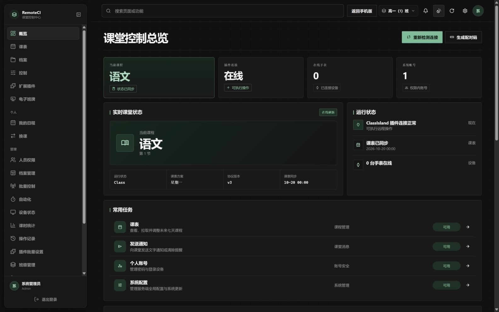
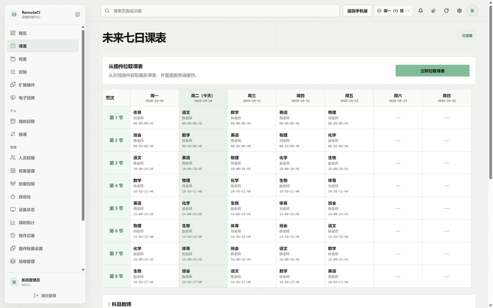
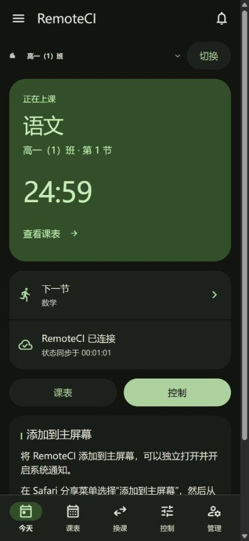
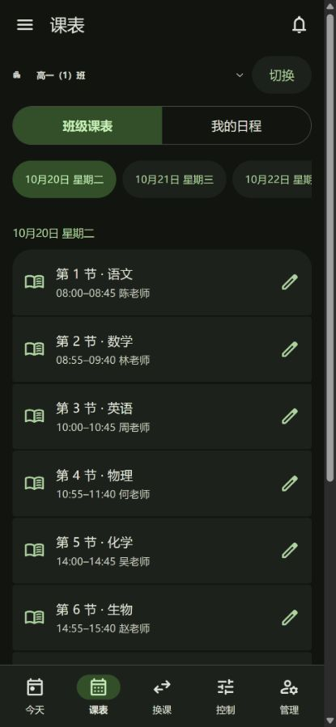
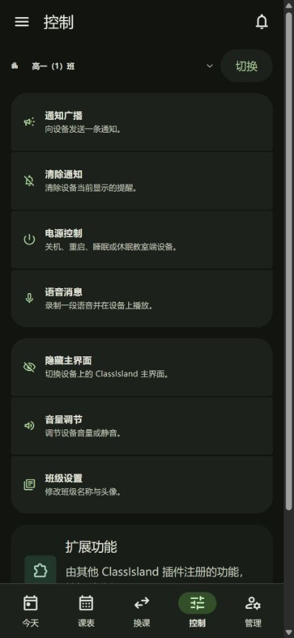
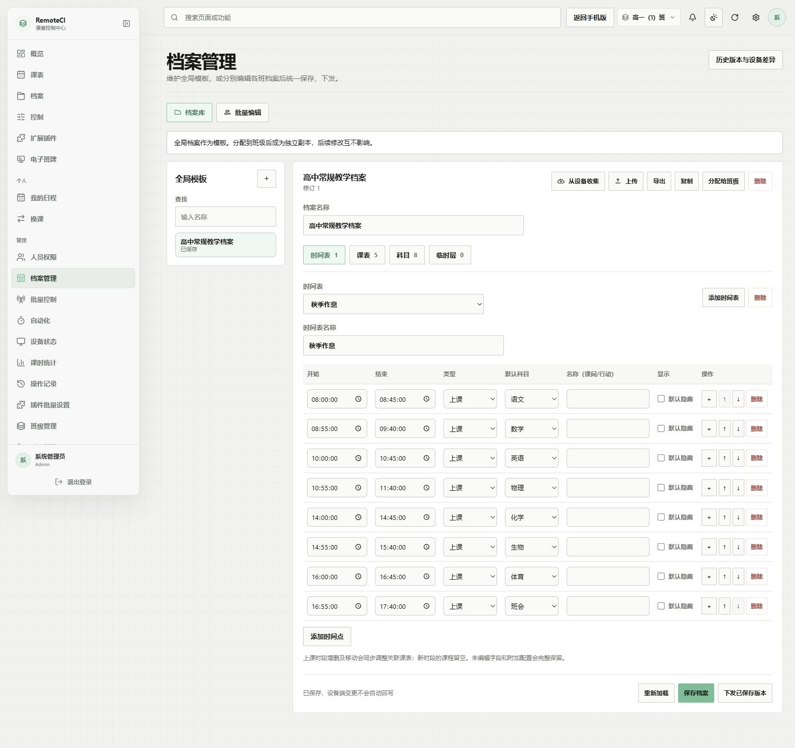
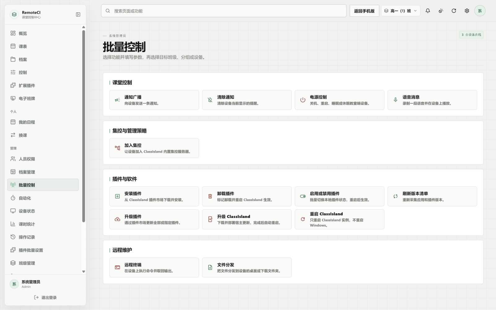
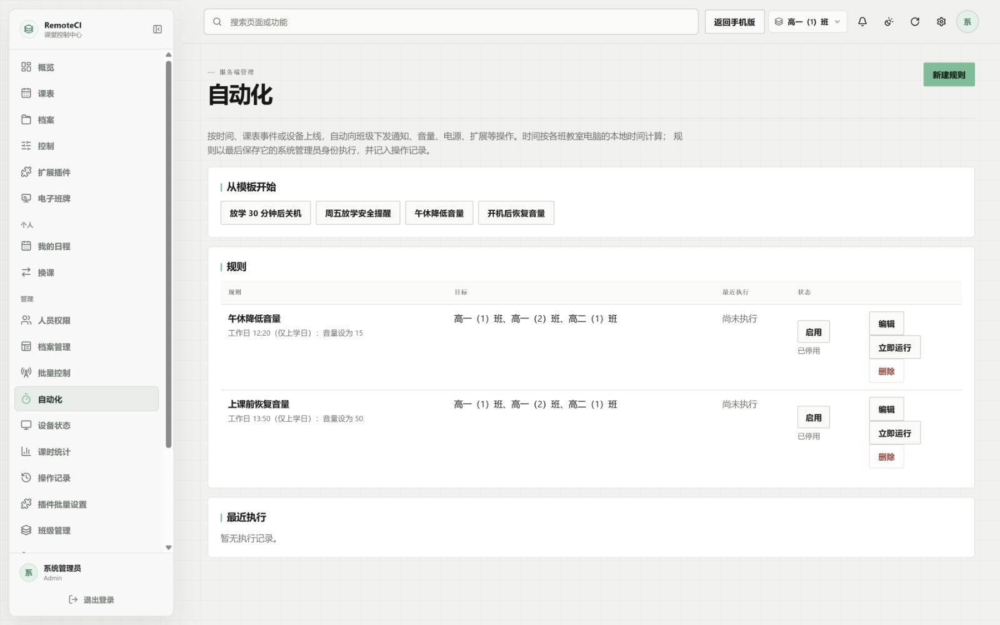

# 🏫 RemoteCI

[](https://github.com/Edge-HH/RemoteCI/actions/workflows/ci.yml)
[](https://github.com/Edge-HH/RemoteCI/releases/latest)
[](LICENSE)

**让 ClassIsland 的课堂状态、课表与控制，从教室延伸到浏览器、手机和手表。**

RemoteCI 是面向 **ClassIsland 2.x** 的课堂联动与集控系统。你可以随时查看课程、发送通知、申请换课，也可以集中维护全校的班级档案、教室电脑与插件，让日常管理按课表自动执行。

系统由 ClassIsland 插件、ASP.NET Core 服务端、桌面与手机 WebUI、Android 和 Wear OS 应用组成，支持 Windows、Linux、Docker 与飞牛 fnOS 部署。各组件通过 **V3 协议**协商能力，具体操作取决于账号权限与教室端支持情况。

[📦 下载发布版](https://github.com/Edge-HH/RemoteCI/releases/latest) · [📖 使用文档](https://edge-hh.github.io/RemoteCI-Docs/) · [🚀 部署指南](docs/deployment.md) · [💬 问题反馈](https://github.com/Edge-HH/RemoteCI/issues)

> [!NOTE]
> 当前开发重点是 WebUI 与集控系统，Android、Wear OS 的功能更新可能稍晚。不同端的入口与能力以实际版本为准。

## 📸 界面预览

以下截图采集自当前仓库源码运行的 WebUI，班级、教师、课程与设备状态均为本地演示数据。手机截图展示的是**手机 WebUI / PWA**，原生 Android 与 Wear OS 应用另行安装。

### 🖥️ 课堂控制总览

当前课程、插件连接、在线设备与常用任务集中展示；支持班级切换、页面搜索和深浅色主题。



### 🗓️ 七日课表

查看未来七天的课程、时间与任课教师，从在线插件拉取最新课表，并按权限交换、替换课程或进行永久换课。



### 📱 手机 WebUI 与 PWA

在手机浏览器中使用今天、课表、换课、控制和管理入口，也可添加到主屏幕。复杂的档案编辑、分组与批量操作可切换到电脑版完成。

| 今天：课程与倒计时 | 课表：按日查看课程 | 控制：课堂常用操作 |
| --- | --- | --- |
|  |  |  |

### 🗂️ 档案与集控工作台

全局模板与班级档案分别维护，支持编辑时间表、课表、科目和临时层，以及批量保存、下发和从设备收集。

<details>
<summary>🗂️ 查看档案管理界面</summary>



</details>

<details>
<summary>📡 查看批量控制界面</summary>

通知广播、语音消息、电源控制、插件管理、软件升级、远程终端与文件分发统一进入操作工作台，再选择目标班级、分组或设备。



</details>

<details>
<summary>⚙️ 查看自动化界面</summary>

按时间、课堂事件或设备上线触发规则。图中两条音量规则为演示配置，处于停用状态。



</details>

## ✨ 可以用它做什么

### 🎒 课堂日常

- **实时课程状态**：同步当前课程、下一节课、上课 / 课间 / 放学状态与阶段倒计时，独立同步未来七日课表。
- **文字与语音消息**：向教室发送 ClassIsland 通知，设置持续时间、重复次数与正文滚动；支持录制语音和清除提醒。
- **常用控制**：显示或隐藏 ClassIsland 主界面、调节音量与静音，并按权限执行关机、重启、睡眠或休眠。
- **多端访问**：电脑使用完整 WebUI；手机可选 Web / PWA 或原生 Android；Wear OS 可查看课表、接收事件并执行授权操作。

### 📚 课表与教师协作

- **课表调整**：交换或替换课程，支持当天临时调整与写入源课表的永久换课；拉取与修改有任务锁和修订校验。
- **换课申请**：老师发起临时换课申请，相关人员审批；具备对应权限的账号可强制换课，处理结果进入个人通知中心。
- **我的日程**：按教师显示名匹配任教课程，汇总跨班级日程，并可添加按星期重复的自定义课程，支持单双周与多周轮换。Android 与 Wear OS 支持上课时自动切换到任教班级。
- **系统日历**：分别同步或订阅“我的日程”和“班级课表”，配置课前提醒。Android 使用本地日历同步，网页端提供私密订阅链接。
- **学期、调休与临时层**：统一设置学期开始日期（教学周与单双周，可同步到教室端 ClassIsland），集中管理节假日、调休补课与档案临时层，配合支持该能力的教室端应用课程安排。

### 🏢 班级管理与全校集控

- **班级、分组与人员**：管理班级、成员和分组，批量导入账号；内置系统管理员、班主任、老师、学生等角色，并支持自定义角色与附加权限。
- **可视化档案管理**：导入、导出和编辑 ClassIsland 档案；把全局模板分配给班级，批量收集、保存与下发；查看历史版本、差异并恢复。
- **按目标批量控制**：按班级、分组或设备下发通知、语音和电源操作，管理插件设置、安装与启用状态，升级插件和 ClassIsland。
- **远程维护**：查看软件版本清单、执行远程终端命令并取回输出，向设备分发文件，或让设备加入 ClassIsland 内置集控。
- **插件扩展**：其他 ClassIsland 插件可注册带参数表单的远程操作与设置页，在 WebUI 按插件分组展示，并统一下发设置。

### ⚙️ 运维与自动化

- **设备状态与告警**：汇总在线状态、课程、音量、版本与今日在线时间；支持在校时段离线告警和恢复通知。
- **应用守护**：统一开启 ClassIsland 退出自启（可设延时，如退出 40 分钟后自启）、意外退出重启与禁止删除；被删除后自动从 C 盘备份恢复、重新启动，并用 ClassIsland 原生弹窗提示由谁统一管理。
- **自动化规则**：按每周定时、上课 / 下课 / 放学或设备上线触发通知、音量、电源、扩展和临时层操作，可限定目标与生效日期。
- **操作记录**：追溯谁从哪个入口、对哪台设备执行了什么操作，以及执行结果；按条件筛选并导出 Excel。
- **课时统计**：汇总实际课时、代课与被代课情况，导出教师汇总和逐节明细；台账从启用后累积。
- **档案差异与电子班牌**：检查教室端档案与服务端的差异，为门口屏或走廊大屏生成可撤销的私密课表链接。

更多使用方式见 [集控运维](docs/operations.md)。配合 [AstrBot 插件](https://github.com/Edge-HH/astrbot_plugin_remoteci)，还可在聊天软件中接收通知、处理换课申请，或通过 API Key 接入其他工具。

## 🚀 快速开始

### 📦 1. 选择需要的组件

从 [GitHub Releases](https://github.com/Edge-HH/RemoteCI/releases/latest) 下载对应平台的发布包。

| 组件 | 获取方式 | 用途 |
| --- | --- | --- |
| ClassIsland 插件 | 插件市场或 `RemoteCI.Plugin.cipx` | 安装到教室电脑，连接 ClassIsland |
| 服务端与 WebUI | Windows / Linux 服务端包、Docker 或 fnOS FPK | 提供账号、课表、控制与管理页面 |
| Android 手机 | `RemoteCI.Mobile-<版本>.apk` | 原生手机体验、桌面小组件与上课状态通知 |
| Wear OS 手表 | `RemoteCI.Watch-<版本>.apk` | 手腕上的课表、消息与控制入口 |

**先部署服务端、连接教室端插件，即可在浏览器使用。** 手机与手表应用按需安装；iPhone / iPad 可使用手机 WebUI 与主屏幕 PWA。

### 🐳 2. 启动服务端

在仓库根目录执行以下命令，从当前源码构建并启动 Docker 服务：

```powershell
docker compose up -d --build
docker compose logs remoteci
```

Compose 默认仅监听宿主机的 `127.0.0.1:8080`，SQLite 数据保存在 `remoteci-data` 命名卷。生产环境在前方配置反向代理，通过 **HTTPS / WSS** 访问，并转发 `/ws` 的 WebSocket 连接。

也可直接部署发布的 Windows / Linux 服务端包；飞牛用户见 [fnOS 安装与打包说明](fnos/README.md)。环境变量、代理示例、备份与更新步骤见 [部署指南](docs/deployment.md)。

### 🔗 3. 初始化并连接教室电脑

1. 打开 WebUI，按初始化向导创建系统管理员和第一个班级，无需预先设置管理员密码。
2. 在该班“概览”页生成一次性插件配对码。
3. 在 ClassIsland 的“RemoteCI 设置”中填写服务器 HTTPS 地址与配对码，保存后重启 ClassIsland。
4. 确认 WebUI 显示插件在线、课程状态和课表已同步，再按需建立人员账号、分配班级与权限。

### ⌚ 4. 接入个人设备

- **手机浏览器 / PWA**：打开同一服务器地址，登录后使用手机界面。iPhone / iPad 可从 Safari 添加到主屏幕，再开启通知与日历订阅。
- **Android**：输入服务器地址、ID 和密码，或扫描 WebUI 概览页生成的一次性手机登录二维码。原生应用还提供桌面小组件、上课状态持续通知与系统日历同步。
- **Wear OS**：填写服务器地址与个人账号登录；可优先局域网连接教室端插件，失败时回退到云端中转。

浏览器推送需要 HTTPS 和服务端可达的推送服务；系统日历按平台定期刷新，临时换课请同时关注个人通知。详见 [手机 Web / PWA](docs/mobile-web.md) 与 [Android 日历同步](docs/android-calendar-sync.md)。

## 🔐 账号与安全

RemoteCI 按账号角色、所属班级和附加权限控制访问，服务端与插件执行端都会重新鉴权。系统管理员还可统一决定班主任能否修改本班名称、头像、拉取课表和修改扩展设置。

- 支持 **TOTP 二步验证与恢复码**，以及个人设备会话管理，见 [二步验证说明](docs/two-factor.md)。
- 插件不接收或保存学生密码及密码哈希；个人设备登录后不保留密码，设备会话密钥由 Android Keystore 保护。
- 手表局域网认证使用一次性 HMAC 挑战；授权镜像离线超过 24 小时后，插件仅允许课程展示并拒绝管理命令。
- 生产环境使用 HTTPS / WSS，局域网 `ws://` 连接仅用于可信网络。数据库、备份及班牌 / 日历私密链接应妥善保管。

漏洞反馈与支持范围见 [安全政策](SECURITY.md)。

## 🧩 系统组成

```text
教室电脑：ClassIsland + RemoteCI 插件
                 ⇅ WebSocket
       RemoteCI 服务端 · 账号 / 权限 / 数据
          ├─ 桌面 WebUI：课堂控制与全校集控
          ├─ 手机 WebUI / PWA：日常访问与通知
          ├─ Android：原生应用 / 小组件 / 日历
          ├─ Wear OS：课表 / 消息 / 授权控制
          └─ API Key / AstrBot / 第三方集成

Wear OS ── 可信局域网直连 ── 教室端插件
```

| 目录 | 内容 |
| --- | --- |
| [`server/`](server/) | ASP.NET Core、Razor WebUI、Identity、SQLite 与集控服务 |
| [`plugin/`](plugin/) | ClassIsland 2.x 插件与 CIPX 打包 |
| [`shared/`](shared/) | C# V3 协议、能力声明与共享模型 |
| [`android/`](android/) | Kotlin / Jetpack Compose 手机应用 |
| [`wearos/`](wearos/) | Kotlin / Compose for Wear OS 应用 |
| [`fnos/`](fnos/) | 飞牛 FPK 工程与打包脚本 |
| [`docs/`](docs/) | 部署、协议、平台与功能说明 |

## 🛠️ 开发与构建

C# 工程使用 **.NET 10 SDK**；Android 与 Wear OS 构建需要 **JDK 17 和 Android SDK**。

```powershell
# C# 工程与测试
dotnet restore RemoteCI.slnx
dotnet test RemoteCI.slnx -c Release --no-restore

# 本地运行服务端
dotnet run --project server/RemoteCI.Server --no-launch-profile

# 构建 ClassIsland 插件包
dotnet build plugin/RemoteCI.Plugin/RemoteCI.Plugin.csproj -c Release -p:CreateCipx=true

# Android 手机
cd android
.\gradlew.bat testDebugUnitTest assembleDebug

# Wear OS 手表
cd ../wearos
.\gradlew.bat testDebugUnitTest assembleDebug
```

Windows 用户也可以双击 [`Build-Latest-Cipx.cmd`](Build-Latest-Cipx.cmd)，选择保存位置后一键构建插件包；脚本会显示插件版本与 SHA-256 校验值。开发约定与提交说明见 [贡献指南](CONTRIBUTING.md)。

## 📖 文档导航

| 想了解什么 | 文档 |
| --- | --- |
| 部署、初始化、配对、代理与更新 | [服务端部署](docs/deployment.md) · [fnOS](fnos/README.md) |
| 手机浏览器、iOS PWA 与通知 | [手机 WebUI / PWA](docs/mobile-web.md) |
| Android 日历导入与自动同步 | [Android 系统日历](docs/android-calendar-sync.md) |
| 设备状态、自动化、审计与课时 | [集控运维](docs/operations.md) |
| 退出自启、崩溃重启与防删除 | [应用守护](docs/app-guard.md) |
| 二步验证与恢复码 | [账号二步验证](docs/two-factor.md) |
| 协议、API 与平台差异 | [通信协议 V3](docs/protocol.md) · [平台说明](docs/platform-notes.md) |
| ClassIsland 插件与扩展接入 | [插件说明](plugin/RemoteCI.Plugin/README.md) |
| 版本变更 | [发布记录](https://github.com/Edge-HH/RemoteCI/releases) · [3.3.0.2 发布说明](docs/releases/3.3.0.2.md) |
| 参与开发与问题反馈 | [贡献指南](CONTRIBUTING.md) · [行为准则](CODE_OF_CONDUCT.md) · [GitHub Issues](https://github.com/Edge-HH/RemoteCI/issues) |

从旧 `v3.2.0` 标签迁移到四段数字版本的已有安装，首次升级需手动安装对应组件，完成迁移后再使用后续自动更新。升级前请备份数据库，并结合发布说明同步更新需要新能力的客户端与教室端插件。

## 📜 开源许可

RemoteCI 使用 [GNU General Public License v3.0](LICENSE) 发布。第三方依赖与许可见 [THIRD_PARTY_NOTICES.md](THIRD_PARTY_NOTICES.md)。
